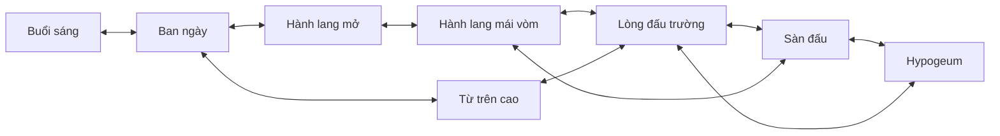
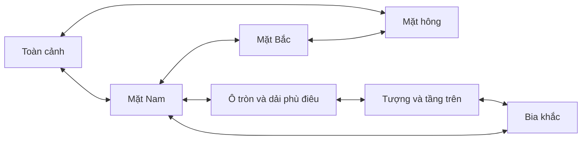
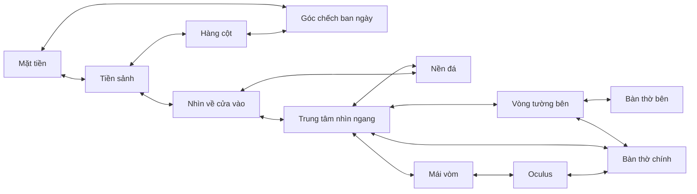

# Bộ tour ảnh ba di sản Roma

## Phạm vi đã hoàn thiện

| Địa điểm | Cảnh/ảnh riêng | Điểm chuyển ảnh | Điểm thông tin | Câu hỏi |
| --- | ---: | ---: | ---: | ---: |
| Colosseum | 8 | 20 | 16 | 3 |
| Khải hoàn môn Constantine | 7 | 16 | 14 | 3 |
| Pantheon | 12 | 30 | 24 | 3 |
| Tổng | 27 | 66 | 54 | 9 |

Mỗi cặp cảnh được nối bằng hai hotspot đối ứng: từ A đến B và từ B về A. Có cả vòng và nhánh, không chỉ một danh sách tuyến tính. Từ bất kỳ ảnh nào đều đến được mọi ảnh khác của cùng tour bằng hotspot. Nút Cảnh trước là lịch sử thao tác riêng, không được dùng để thay thế liên kết quay về trên ảnh.

Đây là tour liên kết các góc chụp 2D. Ảnh có nhiều tác giả và thời điểm; mũi tên không có nghĩa là vị trí chụp liền kề hay một lối đi được xác nhận đang mở ngoài thực địa. Ảnh từ trên cao và ảnh cận chi tiết cũng được ghi đúng vai trò.

## Nội dung và đường nối

### Colosseum

Các cảnh: ngoại thất buổi sáng, ngoại thất ban ngày, hành lang và trụ gạch, hành lang có mái vòm, toàn cảnh lòng đấu, sàn đấu, Hypogeum cận cảnh và ảnh từ trên cao. Ảnh đứng của hành lang giữ nguyên tỷ lệ; có thể kéo lên/xuống hoặc dùng Xem toàn bộ ảnh.

Nguồn thuyết minh: [Colosseum](https://colosseo.it/en/area/the-colosseum/), [khu ngầm](https://colosseo.it/en/marvels/the-underground-levels-of-the-colosseum/), [khán đài và góc nhìn cao](https://colosseo.it/en/marvels/the-cavea-of-the-colosseum-and-the-belvedere-terrace/). Không thêm ảnh/hướng dẫn cho một không gian cụ thể nếu chưa có ảnh được xác minh của không gian đó.

### Khải hoàn môn Constantine

Các cảnh: toàn cảnh cạnh Colosseum, mặt Nam, mặt Bắc, mặt hông, huy chương tròn/dải phù điêu, tượng/tầng trên, và bia khắc. Đã thay ảnh ban đầu mang tên chung chung bằng ảnh mặt hông đúng nội dung; các chi tiết được đặt theo vị trí đã xem trên ảnh.

Nguồn: [Turismo Roma](https://www.turismoroma.it/en/places/arch-costantine), [Công viên khảo cổ Colosseum](https://colosseo.it/en/area/arch-of-constantine-and-meta-sudans/). Các tên chi tiết được giữ ở mức chắc chắn từ hình ảnh và nguồn giới thiệu; không tự nhận diện từng nhân vật trên phù điêu khi chưa đủ căn cứ.

### Pantheon

Các cảnh: mặt tiền, góc chếch sảnh/khối đền ban ngày, nhìn ngang tiền sảnh, hàng cột, từ bên trong nhìn về cửa, trung tâm nhìn ngang, vòng tường bên, bàn thờ bên, bàn thờ chính, nền đá, mái vòm và Oculus. Có bốn cảnh mới: `entrance`, `side`, `chapel`, `floor`. Các ảnh cũ cũng đã được thay để giảm góc ngước lên và bỏ ảnh đêm.

6 ảnh thuộc cùng bộ sáng 09/10/2016, metadata khoảng 10:45–10:58. 6 ảnh nội thất thuộc bộ ngày 07/03/2013 của Szilas, ánh sáng ban ngày; nguồn không cung cấp đủ giờ nên không khẳng định tất cả cùng một buổi sáng. Ảnh Oculus tối ở mặt trong do chênh lệch phơi sáng, metadata vẫn ghi buổi sáng.

Nguồn: [lịch sử Pantheon — Bảo tàng quốc gia Roma](https://direzionemuseiroma.cultura.gov.it/pantheon/cenni-storici/), [giới thiệu công trình](https://direzionemuseiroma.cultura.gov.it/pantheon/).

## Trải nghiệm và tiến độ

Giữ các lựa chọn giao diện đã chốt: ảnh toàn màn hình, mặc định căn giữa/phóng 125%, kéo cả bốn hướng, con trỏ bàn tay luôn hiện; icon ẩn mặc định và hiện khi hover/focus; nút con mắt bật hiện toàn bộ icon và nhãn thao tác khi rê; kính lúp chỉ bật/tắt thẻ tên cảnh hiện tại. Bấm điểm thông tin lần đầu mở bảng Thông tin; bấm lại chính điểm đang mở sẽ đóng chi tiết và thu gọn toàn bộ thanh trái như nút thu gọn. Tiến độ không bị mất. Nguồn ảnh và nguồn thuyết minh nằm trong bảng Thông tin.

66 điểm nối được đặt riêng trên từng ảnh, không suy ra hướng từ thứ tự cảnh. Có biểu tượng trái/phải, tiến vào, nhìn lên/xuống, quay lại và đổi góc nhìn. Ảnh chụp từ trên cao dùng biểu tượng góc nhìn và nhãn rõ ràng, không biểu diễn bằng mũi tên đi bộ ngang. Khi đích là cảnh vừa rời, biểu tượng đổi thành quay lại kèm tên cảnh đó. Khi rê chuột vào vùng chuyển ảnh, dấu bám theo con trỏ trong vùng bấm cố định và hiện tên đích bên cạnh khi bật con mắt; nhãn đổi phía khi gần mép khung. Con trỏ hệ thống vẫn hiển thị. Bàn phím Tab/focus vẫn dùng được; trên cảm ứng có thể bật con mắt để xem các điểm trước khi bấm. Hai trạng thái độc lập: tắt con mắt thì icon chỉ hiện khi hover/focus; tắt kính lúp thì thẻ tên cảnh ẩn. Cả hai mặc định tắt.

Bảng Hành trình có ảnh thu nhỏ, các điểm nối từ cảnh hiện tại và trạng thái Đã xem. Trò chơi có ba câu hỏi riêng cho mỗi công trình, nút xem ảnh gợi ý, phản hồi và lưu kết quả đúng. Tiến độ gồm cảnh đã xem, điểm thông tin đã mở và câu hỏi đã giải. Mỗi tour lưu riêng theo ID/phiên bản và nhớ cảnh đang xem để tiếp tục khi mở lại. Bộ mở rộng dùng version 2; tiến độ mẫu ba ảnh cũ không được tính như hoàn thành bộ nội dung mới.

## Ảnh, quyền sử dụng và hiệu năng

27 ảnh Wikimedia Commons đã kiểm tra trang metadata, tác giả và giấy phép; chỉ chọn CC BY, CC BY-SA hoặc CC0. Danh mục từng ảnh với URL nguồn/giấy phép nằm tại [_local/IMAGE_SOURCES.md](../_local/IMAGE_SOURCES.md). Metadata và SHA-256 nằm trong `_local/sources.json`.

Ảnh chính được giới hạn 1920px, tổng khoảng 25,12 MiB cho cả ba tour; thumbnail giữ tỷ lệ, tổng khoảng 573 KiB. Danh sách không tải cả ảnh chính để làm thumbnail. Khi xem ảnh, ứng dụng chuẩn bị trước tối đa hai ảnh được liên kết để chuyển cảnh nhanh hơn. JSON tour được cache và thử lại khi lỗi.

Ảnh vẫn lưu trong `_local`, không nhập database hoặc đưa vào Docker. Dev/preview trên máy phục vụ được cả ba tour khi dữ liệu địa điểm dùng API thật. Nếu deploy, host JSON/ảnh/thumbnail và đặt `VITE_PHOTO_TOUR_BASE_URL`; build không tự đóng gói thư mục `_local`.

## Kiểm tra

`npm run test:tour` kiểm tra ba bộ dữ liệu, ảnh JPEG, hash, thumbnail, giấy phép, tọa độ hotspot, câu hỏi, điểm gợi ý, liên kết đối ứng và khả năng đến mọi cảnh từ mọi cảnh khác. Kiểm tra cũng từ chối cạnh một chiều, cảnh bị cô lập, đích không tồn tại, đáp án sai cấu trúc và phản hồi HTML thay vì JSON.

Đã đạt kiểm tra TypeScript, tour, hình học bản đồ, trình xem nhúng và khung ảnh; bản build thành công. Đã kiểm tra máy chủ dev trả đúng JSON cho cả ba tour, cùng ảnh chính và thumbnail đại diện mỗi công trình. Build vẫn có cảnh báo kích thước gói của SDK ArcGIS.

Ảnh ghép có đánh dấu hotspot trong `_local/qa/*-tour-review.jpg` phục vụ kiểm tra vị trí trên ảnh gốc. Ảnh `_local/qa/navigation-pointer-browser.png` là ảnh chụp trình duyệt Edge thực tế, thể hiện nhãn đổi góc từ mặt Nam sang mặt Bắc chụp từ trên cao.

Kiểm tra trình duyệt riêng tại `frontend/tests/phototour-browser.mjs` dùng Edge cài sẵn và máy chủ Vite đang chạy, không ảnh hưởng phiên trình duyệt của người dùng. Đã đạt kiểm tra dựng đủ 27 cảnh, bấm 66 đường chuyển và đường đối ứng, biểu tượng quay lại theo lịch sử, bấm thông tin hai lần thu gọn thanh bên, cùng sự bám chuột và nhãn góc từ trên cao bằng sự kiện chuột thật. Chạy từ frontend bằng `node tests/phototour-browser.mjs`. Phần kiểm tra này tập trung vào tour ảnh, không nghiệm thu toàn bộ bản đồ, Sketchfab hoặc tất cả câu hỏi trên mọi thiết bị.

Đã bỏ nút tâm ngắm/về bản đồ trong tour vì trùng mục đích thoát. Chỉ giữ một nút ✕ để đóng tour và trở lại trang trước; Escape cũng đóng tour. Kiểm tra trình duyệt xác nhận độc lập cả bốn tổ hợp bật/tắt con mắt và kính lúp, cùng 27 cảnh/66 đường chuyển hai chiều.
